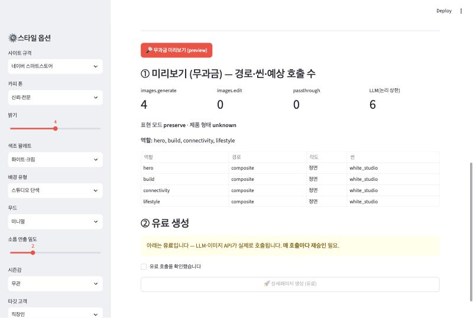
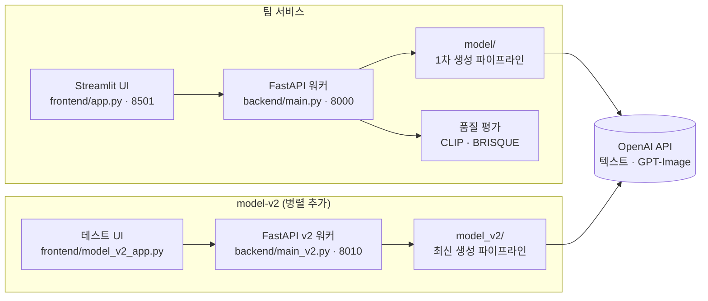

# 🎨 AI 상세페이지 자동 생성 서비스

<p align="center">
  
  
  
  
  
  
</p>

<p align="center">
  <b>코드잇 부트캠프 고급 프로젝트 · 2팀</b><br/>
  제품 사진과 정보만 넣으면 커머스용 상세페이지(긴 이미지)·썸네일·검색엔진용 구조화 데이터를 한 번에 만드는 생성 AI 서비스
</p>

<p align="center">
  <a href="https://app.notion.com/p/38ffc56d6c708069b591e59de1beebc7">📋 협업일지 (Notion)</a> ·
  <a href="./docs/API_GUIDE.md">🔌 API 가이드</a> ·
  <a href="./docs/model_v2/MODEL_V2_HANDOFF.md">📦 model-v2 인계 문서</a>
</p>

---

## 📌 무엇을 만드나

| 입력 | 출력 |
|------|------|
| 제품 사진 (여러 장) · 사용·응용 사진 (선택) | **상세페이지** — 카피 · 생성 이미지 · 스펙 표를 배치한 긴 이미지 |
| 상품명 · 카테고리 · 스펙 · 강조 요청 · 가격 | **썸네일** — 대표 1장 + 갤러리 |
| 스타일 (사이트 규격 · 톤 · 무드 · 밝기 · 창의성 등) | **GEO 산출물** — JSON-LD를 넣은 시맨틱 HTML · FAQ · 근거 없는 수치 경고 |

---

## 🖼️ 실행 화면



> model-v2 테스트 UI에서 **API 키 없이** 실행한 미리보기 화면입니다 (입력은 단색 테스트 이미지 1장).
> 컷 4개(hero · build · connectivity · lifestyle)를 어떤 경로·씬으로 만들지 정하고,
> 실제 생성 시 **이미지 API 4회 · LLM 최대 6회**가 호출된다는 것을 돈을 쓰기 전에 보여줍니다.
> 유료 생성 버튼은 확인 체크를 해야만 켜집니다.

---

## 🏗️ 시스템 구조



`model/`과 `model_v2/`는 최상위 패키지 이름(`baseline` · `composer` · `geo`)이 겹쳐서 한 프로세스에 함께 올릴 수 없습니다.
그래서 **v2는 별도 워커(8010)** 로 띄우고, 팀 워커(8000)와 팀 파일은 한 줄도 바꾸지 않았습니다.

---

## 🔄 생성 파이프라인

```
[제품 사진 + 정보 + 스타일]
        │
        ▼
① 이미지 프롬프트   카테고리 → 아키타입 → 이미지 슬롯(역할) → 슬롯별 프롬프트
        │
        ▼
② 카피·스펙         페이지 카피와 스펙 표를 LLM으로 생성
        │
        ▼
③ 이미지 생성       슬롯마다 GPT-Image 호출 (제품 사진이 있으면 edit, 없으면 generate)
        │
        ▼
④ 상세페이지 조립   블록 · 레이아웃 · 테마로 배치 (Pillow)
        │
        ▼
⑤ 썸네일           대표 + 갤러리
        │
        ▼
＋ GEO 레이어       JSON-LD · FAQ · 근거 없는 수치 경고
```

**model-v2에서 추가된 것**
- **이미지 계획** — 생성 전에 컷마다 처리 경로(합성 · 재편집 · 생성 · 원본 통과)와 씬을 정합니다. 이 단계는 API를 부르지 않아서, 비용이 얼마나 들지 미리 알 수 있습니다
- **제품 합성** — 원본 제품 컷을 배경 제거(`rembg`) 후 생성된 배경 위에 Pillow로 합성
- **씬 템플릿** — 컷 역할별 연출 템플릿

---

## 💡 설계 판단

| 판단 | 이유 |
|------|------|
| **생성과 합성을 분리** (`baseline/` · `composer/`) | 레이아웃만 바꿀 때 이미지를 다시 생성하지 않아도 됩니다 |
| **창의성 1~5** | 낮을수록 원본 제품을 보존하고, 높을수록 자유롭게 재해석하도록 프롬프트를 조정합니다 |
| **근거 없는 수치 경고** | 생성 문장에 입력에 없던 숫자가 나오면 경고를 붙입니다. JSON-LD에는 입력에 있는 필드만 넣습니다 |
| **유료 생성 차단 스위치** | `MODEL_V2_PAID_ENABLED`가 정확히 `1`일 때만 생성 API가 열립니다. 아니면 요청 본문을 읽기 전에 503으로 막습니다 |
| **선택적 관측** | 관측 도구 키가 없으면 관측 코드가 아무것도 하지 않아, 관측 때문에 생성이 멈추지 않습니다. 프롬프트 원문 대신 모델명 · 지연 시간 · 재시도 횟수만 보냅니다 |
| **텍스트 LLM 교체 가능** | OpenAI 호환 엔드포인트로 호출해서 같은 코드로 OpenAI와 로컬 Ollama를 오갈 수 있습니다 |

---

## 📂 폴더 구조

```
TEAM02_ad-generator-ai/
│
├── backend/                  # FastAPI
│   ├── main.py               #   팀 워커 (8000)
│   ├── main_v2.py            #   model-v2 워커 (8010)
│   ├── main_hf.py · model_hf/#   오픈소스 모델 경로 (Qwen2.5 · FLUX.1)
│   └── app/services/         #   파이프라인 · 품질 평가(scorer) · v2 어댑터
│
├── frontend/                 # Streamlit
│   ├── app.py                #   팀 UI
│   ├── model_v2_app.py       #   v2 테스트 UI (무과금 미리보기 → 유료 생성)
│   └── model_v2_demo_app.py  #   v2 데모 모드 (API 호출 없음)
│
├── model/                    # 1차 생성 파이프라인 — baseline · composer · geo
├── model_v2/                 # 최신 생성 파이프라인 — 이미지 계획 · 합성 · 씬 템플릿 추가
├── tests/                    # model-v2 테스트 114개 (전부 mock, API 비용 0원)
│
├── docs/
│   ├── API_GUIDE.md          #   API 명세
│   ├── VERSION_TRACKING.md   #   버전 기록
│   ├── images/               #   README 이미지
│   └── model_v2/             #   인계 문서 · 데모 런북 · 발표 원고
│
├── docker-compose.yml        # 팀 워커(8000) + 팀 UI(8501)
└── requirements.txt          # 로컬 실행용 의존성
```

---

## 🚀 실행 방법

### 1. 환경변수

```bash
cp model/.env.example model/.env          # 팀 워커용
cp model_v2/.env.example model_v2/.env    # v2 워커용
# OPENAI_API_KEY를 채웁니다. TEXT_MODEL · IMAGE_MODEL로 모델을 바꿀 수 있습니다.
```

### 2. Docker로 팀 서비스 실행

```bash
docker compose up -d --build
```

- UI: http://localhost:8501 · API: http://localhost:8000
- Docker 구성에는 **v2 워커가 들어 있지 않습니다.** v2는 아래 로컬 실행으로 띄웁니다

### 3. 로컬 실행

```bash
python3.12 -m venv .venv && source .venv/bin/activate
pip install -r requirements.txt onnxruntime   # rembg는 onnxruntime이 따로 필요합니다

# 팀 워커 + 팀 UI
cd backend && uvicorn main:app --port 8000          # 터미널 1
streamlit run frontend/app.py                       # 터미널 2

# model-v2 워커 + 테스트 UI
cd backend && uvicorn main_v2:app --host 127.0.0.1 --port 8010   # 터미널 1
streamlit run frontend/model_v2_app.py                           # 터미널 2
```

v2 테스트 UI는 API 키 없이도 **미리보기까지** 동작합니다. 실제 생성은 `MODEL_V2_PAID_ENABLED=1`과 API 키가 있어야 열립니다.

### 4. 테스트

```bash
python -m unittest tests.test_model_v2 tests.test_model_v2_isolation \
                   tests.test_model_v2_ui tests.test_model_v2_app tests.test_model_v2_demo
```

실제 LLM · 이미지 API · 외부 HTTP를 한 번도 부르지 않습니다.
2026-10-19 · Python 3.12.13 · Streamlit 1.66.0 · FastAPI 0.146.0, API 키 없이 **114개 통과 · 2개 건너뜀**
(건너뛴 2개는 저장소 밖 샘플 패키지가 필요한 테스트입니다).

---

## 🔧 기술 스택

| 영역 | 기술 |
|------|------|
| 생성 모델 | OpenAI API (텍스트 LLM · GPT-Image) |
| LLM 연결 | LangChain (`ChatOpenAI`) · Ollama (로컬 LLM 전환) |
| 이미지 처리 | Pillow · rembg |
| 서비스 | FastAPI · Uvicorn · Streamlit |
| 평가 | CLIP · BRISQUE |
| 오픈소스 모델 경로 | Hugging Face Transformers · Diffusers (Qwen2.5-7B · FLUX.1-schnell) |
| 테스트 | unittest · Streamlit AppTest |
| 배포 | Docker · Docker Compose |

**모델 기본값** — `model/`은 `gpt-5.4-mini` · `gpt-image-1-mini`, `model_v2/`는 `gpt-5.4-mini` · `gpt-image-2`이며 `.env`로 바꿀 수 있습니다.

**예상 비용** — 생성 1회 약 $0.06~0.08 (팀 추정, 텍스트 4~5회 + 이미지 3~4컷, `gpt-image-1-mini` 기준). 미리보기는 0원입니다.

---

## 👥 팀 구성과 담당 범위

| 영역 | 내용 |
|------|------|
| 서비스 뼈대 | FastAPI · Streamlit 기본 구조 |
| **생성 모델** | `model/` · `model_v2/` 생성 파이프라인, v2 워커 통합, 테스트 |
| 오픈소스 모델 · 평가 | Hugging Face 모델 경로, CLIP · BRISQUE 품질 평가 |
| 배포 | Docker · Docker Compose 구성 |

**제가 맡은 부분은 생성 모델입니다.**
- `model/` — 프롬프트 · 카피 · 이미지 생성, 배경 제거, 상세페이지 조립, GEO 레이어, 창의성 슬라이더, 선택적 관측 (PR #1 · #3)
- `model_v2/` — 이미지 계획, 제품 합성, 씬 템플릿을 더한 최신 파이프라인
- v2 통합 — 별도 워커, 무과금 미리보기 · 유료 차단 스위치, 테스트 UI · 데모 모드, 테스트 114개 (PR #6)

---

## ⚠️ 한계

- 생성 품질을 수치로 평가한 기록이 없습니다
- 업스케일은 LANCZOS 리사이즈이고 초해상 모델은 쓰지 않았습니다
- 배경 제거는 `rembg`(u2net) 기준이라 경계가 복잡한 제품에서 정밀도가 떨어질 수 있습니다
- v2 워커는 Docker 구성에 포함돼 있지 않고, 워커 자체에 인증이 없어 기본 바인딩이 `127.0.0.1`입니다
- 유료 차단 스위치는 비용 사고 방지 장치이지 접근 제어가 아닙니다
